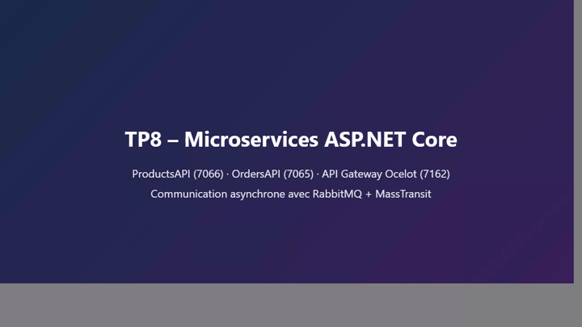

# TP8 – Introduction aux microservices avec ASP.NET Core

Solution `MicroservicesApp` composée de 3 projets Web API et d'une bibliothèque partagée :

| Projet | Rôle | Port (https) |
|---|---|---|
| **ProductsAPI** | Microservice produits (émetteur des messages RabbitMQ) | 7066 |
| **OrdersAPI** | Microservice commandes (consommateur des messages RabbitMQ) | 7065 |
| **ApiGateway** | API Gateway **Ocelot** (point d'entrée unique) | 7162 |
| **Shared** | Classe `ProductCreated` partagée (message RabbitMQ) | – |

## Vidéo de démonstration (branche `demo`)

Tu es sur la branche **`demo`** : la démo (2 min 41, sans son, sous-titrée en français) se lance toute seule ci-dessous, rien à installer :



Contenu : interface RabbitMQ (Overview, Connections, Channels, Exchanges, Bindings, Queues, Consumers),
ajout d'un produit dans Swagger, synchronisation ProductsAPI → OrdersAPI via RabbitMQ, appels à travers
la gateway Ocelot.

### Vidéo complète HD (branche `main`)

La vidéo en meilleure qualité (1280×720, `.webm`) est dans la branche **[`main`](https://github.com/Cha3yassin/tp8-.net/tree/main)**,
fichier [`demo/TP8_demo.webm`](https://github.com/Cha3yassin/tp8-.net/blob/main/demo/TP8_demo.webm).

GitHub ne lit pas ce format dans la page : ouvrir le fichier puis cliquer sur **Download** (ou **View raw**).
Elle se lit ensuite dans **Chrome / Edge / Firefox** (glisser le fichier dans le navigateur),
le **Lecteur multimédia de Windows** ou **VLC**.

Lien direct de téléchargement :
https://github.com/Cha3yassin/tp8-.net/raw/main/demo/TP8_demo.webm

## Technologies

- ASP.NET Core Web API (.NET 10), Entity Framework Core + SQL Server LocalDB
- Ocelot 18.0.0 (API Gateway) – routes dans `ApiGateway/Ocelot.json`
- RabbitMQ + MassTransit (communication asynchrone)

## Lancer le projet

1. RabbitMQ dans Docker (port AMQP exposé sur **4001**) :
   ```
   docker run -d --hostname my-rabbit --name ecomm -p 15672:15672 -p 4001:5672 rabbitmq:3-management
   ```
   Interface d'administration : http://localhost:15672 (guest / guest)
2. Créer les bases (Console du Gestionnaire de package, pour **ProductsAPI** puis **OrdersAPI**) :
   ```
   Update-Database
   ```
3. Démarrer les 3 projets (Plusieurs projets de démarrage : ProductsAPI, OrdersAPI, ApiGateway).

## Routes de la gateway

| Gateway | Microservice |
|---|---|
| `GET/POST/PUT /apigateway/Products` | `ProductsAPI /api/Products` |
| `GET/POST /apigateway/products/{id}` | `ProductsAPI /api/Products/{id}` |
| `GET/POST/PUT /apigateway/Orders` | `OrdersAPI /api/Orders` |
| `GET/POST /apigateway/Orders/{id}` | `OrdersAPI /api/Orders/{id}` |
